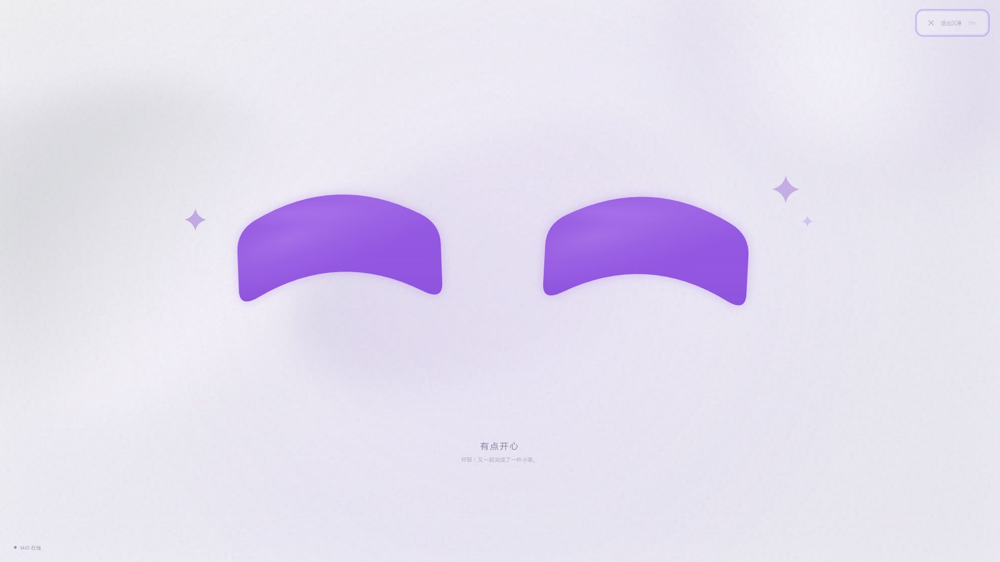
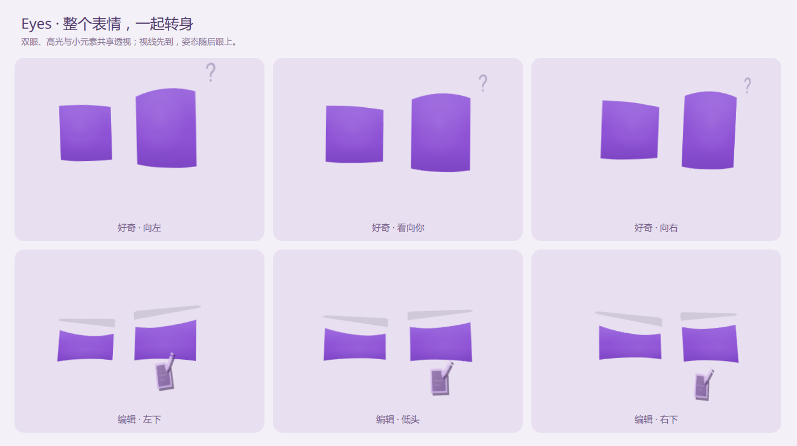

# Eyes

Eyes 是本项目唯一的产品名称。

Eyes 是 Agent harness 的桌面存在层。Agent 工作时，它在壁纸上方铺一层半透明磨砂玻璃，用一双紫色抽象眼睛表达好奇、思考、专注、等待和完成。动画由连续的弹簧参数驱动，支持自动眨眼、八方向视线、系统光标跟随和基础情绪。



桌面版使用 Plasma 6 原生壁纸插件，磨砂和双眼绘制在壁纸内部，桌面图标、面板与普通窗口始终位于它上方。插件不接收输入，后台只负责状态、全局光标与托盘。浏览器和桌面现在默认使用 **[Rive 开源运行时](https://github.com/rive-app/rive-runtime)**，共同播放同一份 `assets/eyes/eyes.riv`：完整状态机、连续表情混合和向量绘制都由 Rive 执行。`eyes-core.js` 保留共享动作设计、弹簧、注意力和布局；Sentient 五点样条作为素材的几何来源和浏览器降级绘制路径。

## 快速开始

浏览器调试台需要 Node.js。首次运行先安装固定版本的 Rive 依赖：

```bash
npm ci
npm run dev
```

打开 <http://127.0.0.1:5173/>。静态服务只监听本机回环地址。

KDE 桌面版需要 Plasma 6 Wayland、CMake、Ninja，以及 Qt 6 Base / Declarative / WebSockets / ShaderTools。Arch Linux 可使用：

```bash
sudo pacman -S --needed cmake ninja qt6-base qt6-declarative \
  qt6-websockets qt6-shadertools plasma-workspace
```

构建桌面宿主和原生 Rive GPU 插件（首次构建下载约 28MB 固定版本源码并核对 SHA-256；之后使用构建缓存，不在运行时联网）：

```bash
npm run desktop:build
```

安装到用户目录、保留原壁纸并注册应用菜单入口。默认不会登录自启动，也不会在安装结束时启动 Eyes；更新绘制代码时会刷新 Plasma 桌面和面板，应用窗口保留：

```bash
npm run desktop:install
```

安装后可在应用菜单中搜索 **Eyes**，点击启动；也可以将其拖到桌面、固定到任务栏或通过右键菜单隐藏和退出。应用入口使用安装目录下 `bin/eyes` 的绝对路径，不依赖图形会话是否包含 `~/.local/bin`。

安装后的常用命令：

```bash
eyes show
eyes start
eyes thinking
eyes working
eyes waiting
eyes complete
eyes hide
eyes status
eyes quit
```

`start`、`thinking`、`working`、`waiting` 会显示对应神态，`complete` 显示开心表情并在 4.5 秒后淡出。`blink`、`look X Y` 和 `emotion ID` 可用于调试。首次执行显示命令时，客户端会自动启动后台宿主。

安装后默认不开机自启，也不会预先运行后台。首次从应用菜单启动，或执行 `eyes show` 时，服务才按需启动。用户执行 `eyes hide` 或选择托盘“隐藏 Eyes”后，隐藏意图会持久保存：后台、Codex hook 和工作状态仍可更新，但不会重新绘出眼睛或发布光标注意力；只有 `eyes show` 或托盘“显示双眼”能恢复。隐藏时停止动画和光标轮询，淡出结束后卸载眼睛的原生渲染实例并释放对应 GPU 目标。`eyes quit` 与托盘“退出”会结束宿主并保持退出状态，智能体活动不会自动拉起；用户服务只在异常退出时重启。最后的全局光标位置仍会保留，明确显示后继续跟随。显示时默认每秒更新 60 次，共享弹簧按真实经过的时间推进；原生向量绘制只在模型更新时执行，Plasma 的其他动画复用已绘制的眼睛纹理。屏幕输出尺寸、8×/4×/2× 多重采样和 SMAA 保持原有质量。

需要降低负载时，可将 Eyes 壁纸的 `AnimationFps` 配置改为 `30` 或更低，支持范围为 20–60。常驻策略、测量方式与取舍见 [ADR-008](docs/decisions/008-demand-driven-resident-rendering.md)。

八种情绪之外，新增 20 种工作状态：听任务、做计划、读文件、找资料、创建、编辑、跑命令、用 MCP、调工具、用 skill、跑测试、排错误、做审查、保存、分派、等回应、遇阻、再试试、写总结和完成。眼形各有起势、停顿与收束：读文件逐行扫视，编辑低头落笔，命令执行收眼盯住终端，MCP 先探出一只眼再让另一只跟上，重试则先收束再振作。纸张、铅笔、迷你终端、连接节点、小手册和勾选框都是共享 Rive 素材里的向量道具，具有正面、侧面厚度和切面明暗，并随眼睛视角做小幅透视旋转。纸笔进入双眼下方的操作区域，放大镜靠近眼睛，笔迹、终端输出、连接头和翻页与眼睑共用动作节奏。关闭辅助元素后仍保留动作与眼形区别。

调试台按理解、动手、协作、检查、暂停、收尾分组，约 70 秒的工作周期演示覆盖全部工作状态，可随时停止或切换。支持自动眨眼、双眨眼（Shift + 空格）、八方向视线、鼠标跟随、点击双眼互动、活泼程度调节、浅色 / 暮色壁纸、磨砂浓度和沉浸预览。减少动态效果时保留静态神态和道具。

八种表情共用无圆角矩形眼面，上、下眼睑各由五个控制点驱动。Sentient Eye Engine 的样条内核让内眼角、外眼角和中段张力能独立变化，所有参数仍通过连续弹簧过渡。开心保持等厚弯带，好奇睁眼探看，思考半眯并望向侧上方，专注收紧内侧眼睑，惊讶双眼张开，困倦低垂，困惑一侧抬眼、一侧怀疑地收住。默认配合少量辅助元素：专注与困惑的切面眉、好奇与困惑的小问号、开心的双星、惊讶的短线和困倦的两个小 Z。待命保持安静。它们是同一 Rive 素材中的向量，主画面、按钮缩略图和桌面同步显示。设计与兼容约定见 [辅助元素决策](docs/decisions/007-shared-expression-accessories.md)。

[打开八种表情对照](http://127.0.0.1:5173/gallery.html)，可同时观察等尺寸的八组眼睛，重播从待命进入表情的过程、播放微动作、隐藏名称或点击单个画面眨眼。主调试台保留光标、工作周期和沉浸预览。

[打开二十种工作状态对照](http://127.0.0.1:5173/gallery.html?view=activities)，比较同一引擎中的眼形、道具和表演节奏。状态设计与接入边界见 [ADR-009](docs/decisions/009-agent-activity-performances.md)。

每种情绪包含起势和三种互补动作：开心提眼后留下笑意，好奇先探看、另一眼跟上，再略收眼检查；思考收眼、停顿后放开；困惑回看时转移两侧眼睑斜率和张力；困倦慢慢下垂后短暂抬起；专注保留稳定注视。视线、眼睑和反光共用一个可暂停时钟，切换后从同一动作起点开始。上下眼睑分担不同的行程，重复发送同一状态不会重播起势。辅助元素随同一组表情弹簧淡入淡出，切面眉略长于眼宽，具有厚眉头、轻折峰和渐细眉尾，随眼睑起伏；星星随笑眼轻提；问号不会随眨眼挤扁，也不使用独立闪烁循环。思考只由半眯眼形与侧上方视线表达，不再叠加额外装饰。减少动态效果保留静态神态提示。

快捷键：`1`–`8` 切换神态；空格眨眼；方向键移动视线；`F` 切换沉浸；`Esc` 退出沉浸。系统减少动态效果偏好会关闭自发动作与回弹，保留手动切换和注视。切到后台时暂停画布。

内部高光使用低对比紫色漫射场，不再描画一只缩小的眼睛。Rive 主光的中心根据真实样条曲面定位，以宽阔的径向渐变绘制，并裁切在同一眼形内，随开合和眨眼变形。主光待命时位置固定，两块更淡的小矩形反光同向穿行、交错淡入淡出，单块强度低于 3%；关闭自然动作或减少动态效果时混合回静止姿态。表演与材质见 [docs/MOTION.md](docs/MOTION.md)，引擎选型与限制见 [Rive 决策](docs/decisions/005-rive-performance-runtime.md)。

光标跟随默认开启。浏览器调试台覆盖整个页面和沉浸模式，包括控制区，只跟踪页面内指针；安装后的桌面版由 KWin 脚本接收全局系统光标，并将坐标映射到每块显示器。视线按眼睛中心映射并平滑限幅，高光略迟于眼形响应，并在眼面范围内明显偏向目标。眼形、间距与轻微倾斜共同辅助注意表达：目标一侧略舒展，另一侧轻收；侧看时略收拢间距，上看时微睁，下看时微眯。形变幅度约为原眼形的几个百分点，并保留当前表情。光标停下会持续注视该位置；桌面版保留 KWin 最后一个有效坐标，不因静止超时切回原点。尚未取得有效坐标时保留当前表情的自然视线。浏览器中离开页面后短暂停留再回归。键盘和方向按钮可暂时指定视线，下一次光标移动会恢复跟随。右侧光标按钮可关闭浏览器内跟随。

开心时使用上下两边同步弯曲、厚度均匀的长方形。沉浸模式按屏幕宽高计算双眼尺寸，不设固定像素上限，双眼使用纵向更修长的比例，静止中心上移到屏幕高度约 43%，纵向注意位移收敛为原来的 70%；16:10 屏幕上的待命眼高约占屏幕 45%，避免只集中在下半屏。眼形采用无圆角的弯带，主体与轮廓均清晰，仅保留像素级抗锯齿，不使用边缘羽化、眼形模糊或外围光晕；文字位于眼睛下方。控制台预览与沉浸模式共用这套自适应构图。

整个表情现在共用一个三维朝向：双眼、内部高光、眉线、问号、星星和工作道具一起转身。向右看时左侧靠近观者、右侧退入屏幕，上下看同时产生俯仰；视线先到，整体转向稍后跟上，再平稳停住。思考略抬头、编辑低头、开心轻提、困倦微垂，仍由原有神态与动作决定。转向受限于约 22° 的左右转动和 16° 的俯仰，保留清晰矩形眼形与原有情绪。浏览器、Canvas 降级和 Plasma 共享同一投影；减少动态效果时保留稳定朝向。见 [ADR-010](docs/decisions/010-shared-face-perspective.md)。



## 接入 harness

八种情绪和二十种工作状态的混合权重由共享弹簧连续驱动，支持过渡中再次切换；Rive 将这些权重作用于眼睑、位置和材质，不替换离散眼睛图片。`eyes.js` 内的 `Eyes` 可复用到提供 Canvas 的宿主；本地预览通过 `window.eyes` 暴露接口：

```js
window.eyes.start();              // 收到任务 → 好奇
window.eyes.thinking();           // 规划 → 思考
window.eyes.working();            // 工具执行 → 专注
window.eyes.waiting();            // 需要输入 → 耐心倾听与暂停提示
window.eyes.complete();           // 完成 → 开心
window.eyes.idle();               // 待命
window.eyes.setEmotion('sleepy'); // 也可直接指定八种神态
window.eyes.look(-1, 1);          // 左下方，随后自动回归
window.eyes.blink(true);          // 双眨眼
window.eyes.setActivity('creating'); // 创建：抬眼、新纸与加号
window.eyes.setActivity('editing');  // 编辑：低头、纸笔
window.eyes.setActivity('running');  // 命令：专注、迷你终端
window.eyes.setActivity('mcp');      // MCP：探出与连接节点
window.eyes.setActivity('skill');    // skill：领会、小手册
window.eyes.activities;             // 可用工作状态与说明（只读）
```

Agent harness 推荐只发送生命周期命令：

```bash
eyes start
eyes thinking
eyes working
eyes waiting
eyes complete
```

精确表达当前动作时发送 `eyes activity ID`，浏览器发送 `window.eyes.setActivity(ID)`，共享模型使用 `simulation.setActivity(ID)`：

| 阶段 | 可用 ID |
| --- | --- |
| 理解 | `listening`、`planning`、`reading`、`searching` |
| 动手 | `creating`、`editing`、`running` |
| 协作 | `mcp`、`tool`、`skill`、`delegating` |
| 检查 | `testing`、`debugging`、`reviewing` |
| 暂停与恢复 | `waiting`、`blocked`、`retrying` |
| 收尾 | `saving`、`summarizing`、`complete` |

`eyes activity complete` 与 `eyes complete` 一致，开心 4.5 秒后淡出；`waiting` 使用柔和的倾听眼形与暂停符号。未知工作状态会报错并保留当前画面与完成计时。重复状态不会重播起势，光标关注优先于工作中的自然扫视。

`start` 自动启动后台宿主并显示好奇；`thinking`、`working`、`waiting` 分别表达规划、工具执行和等待输入；`complete` 开心约 4.5 秒后淡出；`idle` 只是会话结束的临时隐藏，下一项活动仍可显示。`hide` 则是持久用户隐藏，后续 Codex 活动只更新后台状态而不会显现，直到 `eyes show`。`quit` 结束宿主并保持退出，后续活动不会自动启动。桌面宿主通过 `$XDG_RUNTIME_DIR/eyes.sock` 接收命令。每块显示器的原生壁纸插件共享相同的工作状态；光标位置由轻量 KWin 脚本经 `org.eyes.Desktop` D-Bus 服务送入动画，驱动双眼眼形、眼距、高光的位置和注意力节奏。

### Codex Desktop

用户级 Codex hooks 安装在 `~/.codex/hooks.json` 与 `~/.codex/hooks/eyes-codex-hook.py`，所有项目共享。安装器把 Eyes 条目合并到现有配置，不覆盖其他工具的 hooks。适配器记录并行工具调用，忽略自身失败且不输出上下文，不会影响 Codex 的工具决策。安装或更新后，若 Codex 将 hooks 标为 `untrusted` 或 `modified`，在 `/hooks` 中审查并信任，再新建线程使配置生效。

仓库中的 `integrations/codex/` 是可重复安装的源；`npm run codex:hooks:install` 可单独更新用户级 hooks。不要把同一套 hooks 再放进项目 `.codex/hooks.json`，否则会重复启动事件。事件映射、动效防抖和限制见 [docs/CODEX.md](docs/CODEX.md)。

用户隐藏状态保存在 `$XDG_STATE_HOME/eyes/user-visibility`（默认 `~/.local/state/eyes/user-visibility`，权限 `0600`）。它只记录 `hidden` 或 `quit`，不包含会话、提示词或工具内容。Codex hook、命令客户端和 systemd 用户服务都尊重它；设计与恢复规则见 [ADR-011](docs/decisions/011-user-visibility-intent.md)。

Eyes 只在显示周期临时替换壁纸插件，不永久接管桌面。首次显示前，后台把每块桌面的原插件和完整壁纸配置写入 `$XDG_STATE_HOME/eyes/wallpaper-origin.json`（默认 `~/.local/state/eyes/wallpaper-origin.json`，权限 `0600`），再挂载 Eyes；隐藏、`complete` 淡出结束和退出时恢复原插件、图片、纯色与填充方式，异常中断则由下一次启动或安装修复。面板永远不写入该状态，也不会被修改。用户在 Eyes 显示期间主动换壁纸时，新选择优先，旧快照不会被写回。安装和普通启动只执行恢复，不会把 Eyes 设为壁纸。壁纸包名称不会被提前解析成单张亮色图片：Eyes 场景交给 Plasma 的 `DayNightWallpaper` 按当前颜色方案选择 `images` 或 `images_dark`，因此暗色壁纸在显示期间仍保持暗色。状态只包含桌面插件名和壁纸配置，不包含文件内容或会话数据，设计与迁移规则见 [ADR-013](docs/decisions/013-reversible-wallpaper-mount.md)。

壁纸插件使用更强的纯模糊并缓存结果，不依赖 KWin blur；不叠加白色或染色蒙版，也不调整壁纸的饱和度、亮度或对比度。Rive 通过 Qt Quick RHI 在 GPU 绘制向量，输出纹理尺寸随屏幕构图放大，不把固定低分辨率画面拉伸到桌面。`FrameAnimation` 驱动共享弹簧输入。状态桥只监听 `127.0.0.1:38271`；客户端等 URL 设置完成后再启动，并在连接后主动请求一次快照。托盘菜单可明确显示、持久隐藏、演示或完全退出。

## 仓库结构

```text
eyes-core.js                    共享表情、样条几何、弹簧、高光与 Canvas 渲染
vendor/sentient-eye-engine/      MIT 样条内核移植、许可证与固定上游源码
gallery.html gallery.js          真实共享引擎的情绪与工作状态对照
eyes.js                         浏览器画布与生命周期适配
rive-renderer.js                Rive WASM、共享素材和浏览器绘制适配
assets/eyes/                    共享 Rive 素材与源码/二进制校验信息
tools/build-rive.mjs            从共享眼睑和动作台本生成 RML、编译素材
cmake/Rive.cmake                固定源码、许可证和 Qt Quick GPU 插件构建
app.js index.html style.css     浏览器调试台
desktop/main.cpp                无窗口后台、命令、WebSocket 光标与托盘桥
packaging/plasma-wallpaper/     Plasma 原生壁纸、GPU 眼睛与磨砂缓存
tests/qml/                     GPU 实际像素、表情和眨眼回归
bin/eyes                        本地控制客户端
packaging/                      用户安装、应用菜单入口与 KWin 光标桥
tests/eyes.test.mjs             动画与构图回归测试
tests/packaging.test.mjs        升级清理与壁纸保留回归
tests/codex-hooks.test.mjs      Codex 生命周期映射、用户安装与静默失败回归
integrations/codex/             用户级 Codex Desktop 生命周期接入源
docs/MOTION.md                  眼神表演、高光和注意力动作约定
docs/CODEX.md                   Codex hooks 映射、信任与限制
docs/decisions/                 架构决策与生命周期约定
docs/gallery/                   开发过程视觉快照
AGENTS.md                       仓库记忆与后续维护约束
```

## 开源引擎与素材制作

Rive 运行时采用 MIT 许可，Qt 桥接基于 [basysKom/RiveQtQuickPlugin](https://github.com/basysKom/RiveQtQuickPlugin) 的 LGPL-3.0-or-later 代码，以独立动态库安装。版本、源码地址和许可证见 [vendor/rive](vendor/rive/README.md)。桌面适配补齐 Qt 6 枚举注册，所有输入采用小写以兼容桥接层。桌面包安装共享 `.riv` 文件、动态插件和第三方许可证。

素材由 `tools/build-rive.mjs` 从共享八种情绪、二十种工作状态和动作函数生成；每种情绪包含静止、起势、主动作、跟随和收束五种基姿，共享时钟和弹簧连续驱动它们的混合。Rive 不再自行循环眼睑动画，播放进度不同也会得到相同的动作姿态。五点眼睑采用端点切线约束的连续曲率样条，去掉弧线两侧不自然的反向弯折，保留矩形眼角与开心等厚。详见 [ADR-006](docs/decisions/006-continuous-lids-and-shared-performance-clock.md)。测试同时执行真正的 Rive WASM 和 Qt GPU，检查曲率、同步、起势、暂停和像素边界。浏览器启动失败时显示共享样条降级画面，并在控制台报告错误。

桌面眼睛在独立目标中优先使用 8× 多重采样，按显卡支持情况回退到 4×、2× 或单采样，并保留 SMAA。曲线细分精度提高到 4096 单位，最终画面使用线性取样和正确的预乘透明度合成，减少浅弧线和缓慢移动时的台阶、暗边。它不改变 Plasma 整体采样设置。像素回归覆盖全部 28 种姿态的三个亚像素位置，同时检查中间覆盖和最多两物理像素的过渡，保留清晰轮廓。

修改表情或台本后，用官方 Rive CLI 1.7.0 在本地重新生成素材：

```bash
EYES_RIVE_CLI=/path/to/rive npm run eyes:author
```

CLI 和官方编辑器并非本项目所声明的开源运行时；CLI 只用于制作素材，普通构建直接使用已提交的 `.riv`。制作过程使用 `--verify` 和 `--once`，不登录、不上传，也不依赖脚本签名或付费导出。生成的 RML 位于 `build/rive/scene.rml`，校验记录确保素材不会落后于共享源码。

接入 [Sentient Eye Engine](https://github.com/Sentient-LabsDev/Sentient-Eye-Engine/tree/42761191371f328361b62b5cfd095aac3f58c33d) 的五点样条形变内核，固定版本并保留 MIT 许可。当前移植范围是曲线与控制点模型；Pygame 窗口、随机抖动、椭圆主体和外围光晕未引入。Eyes 继续提供弹簧、注意力、矩形弯带和曲面材质。

浏览器先加载 `vendor/sentient-eye-engine/rig.js` 再加载共享核心；CMake 将相同的两份源码合并为 QML 使用的 `build/wallpaper-ui/eyes-core.js`。原 `EyeScene.qml` / GLSL 路径保留为共享几何参考与回归对象，产品使用 `RiveEyeScene.qml`。更新样条移植时须遵循 [集成说明](vendor/sentient-eye-engine/README.md)，并重新生成 Rive 素材。

## 验证

```bash
npm test
npm run check
npm run desktop:build
```

`npm run desktop:test` 使用 Qt 6 检查 GPU 实际像素输出、全部姿态、透明边界、注意力与眨眼，需要真正曝光并支持 ShaderEffect 的 RHI 后端。当前主桌面无法暴露测试窗口时，应使用隔离的虚拟 KWin 会话，例如以 `dbus-run-session -- kwin_wayland --virtual --xwayland --socket eyes-gpu-test --width 2240 --height 1400 --exit-with-session <wrapper>` 启动 `qmltestrunner -input tests/qml`；不要把 `QT_QPA_PLATFORM=offscreen` 当作 GPU 回归，离屏后端会让 ShaderEffect 像素测试失败或挂起。Qt 6 工具目录可通过 `QT6_BIN_DIR` 指定。`npm test` 检查表情间的物理收敛、帧率稳定性、单 / 双眨眼时序、开心弯带几何、全屏构图、高光继承和注意力行为。`npm run check` 检查脚本语法，`npm run desktop:build` 编译 Qt 宿主。涉及安装或桌面层时应重新运行 `npm run desktop:install`、`eyes status`，确认应用菜单入口有效、没有 XDG autostart 项且 systemd 用户服务未启用，并检查壁纸层位于普通窗口下方、输入完全穿透、全局光标能驱动视线和高光。

`npm run desktop:wallpaper:test` 使用临时配置、临时状态目录和独立 D-Bus 驱动真实桌面宿主，断言启动时先恢复旧挂载，并只在显示期间挂载、隐藏和退出时恢复。该测试与光标/活动测试一样要求先停止正在运行的 Eyes 宿主，以独占本地桥接端口；它不会修改真实 Plasma 配置。

`npm run desktop:hidpi:test` 在 X11 / XWayland 实际窗口中验证双倍像素密度。Rive 目标尺寸包括屏幕像素密度，再映射回逻辑构图。测试窗口会适配屏幕，避免被窗口管理器裁切。Qt 6.12 离屏后端的高 DPI 截图连普通矩形也会截错，因此这项检查使用实际窗口后端。

`npm run desktop:activity:test` 在独立 D-Bus 和临时运行目录中测试真实宿主的所有工作状态、非法输入、完成计时及隐藏后继续运行。与光标桥回归一样，先停止已运行的桌面宿主，以独占本机桥接端口。

详细动作台本、研究参考和视觉约束见 [docs/MOTION.md](docs/MOTION.md)；维护须知与不可破坏的桌面约束见 [AGENTS.md](AGENTS.md)；开发截图见 [docs/gallery](docs/gallery/)。

## 命名与升级

产品名称统一为 **Eyes**。命令为 `eyes`，桌面后台为 `eyes-desktop`，浏览器接口为 `window.eyes`；可用 `EYES_DESKTOP_BIN` 指定后台程序，`EYES_INSTALL_PREFIX` 指定安装位置。桌面壁纸插件 ID 为 `org.eyes.wallpaper`，D-Bus 服务和接口为 `org.eyes.Desktop`，光标脚本 ID 为 `eyes-cursor`。

重新运行 `npm run desktop:install` 会保留壁纸图片、停止旧后台、卸载旧光标脚本，并清理旧命令、插件和旧自启动项。升级后请将外部 harness 配置中的旧命令与浏览器调用更新为上面的接口；不保留旧名称别名。默认按需启动与应用菜单注册见 [ADR-012](docs/decisions/012-opt-in-application-startup.md)，命名与清晰轮廓的决策见 [ADR-002](docs/decisions/002-eyes-identity-and-crisp-contours.md)。
